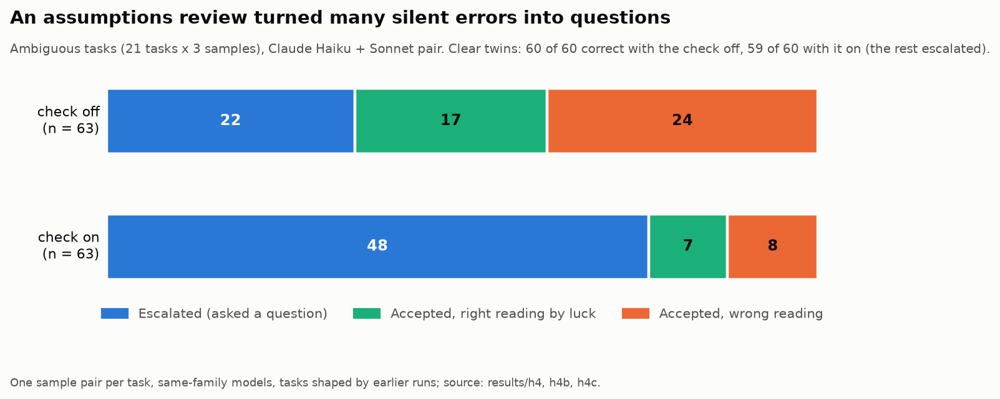

# Tare

**Independent AI double programming for clinical trial datasets, and a measurement of when it fails.**

*To tare a scale is to zero it before weighing, so the reading you get is true.*

> Status: research prototype with results from a first set of runs; every number below comes from a logged run under `results/`. Write-up with the full tables and limits: [`docs/11_WRITEUP.md`](docs/11_WRITEUP.md).

## Why

Pharma companies derive analysis datasets (CDISC ADaM) from collected trial data, and every efficacy and safety table submitted to regulators is built from them. AI coding tools can now draft that code. The dangerous failure is code that runs cleanly and quietly produces a wrong value. The industry's safeguard is **double programming**: two programmers implement the same spec independently and compare outputs.

Tare asks: **when AI writes clinical code, does AI double programming catch the errors?**

## What it does

- **Benchmark (`benchmark-v1.0`, frozen):** 79 ADaM derivation tasks with exact answers generated by the open-source `admiral` templates, plus controls against memorization (sponsor-specific spec variants, perturbed inputs, a held-out ophthalmology slice) and deliberately ambiguous specs with matched clear twins (29 ambiguous tasks, 28 with a clear twin, 61 stored alternative readings). The tag `benchmark-v1.0` covers every task except round `u1`, a later set of ambiguous tasks kept outside it. Specs are written in our own words; ambiguity labels are single-author.
- **Harness:** two AI programmers (Claude Haiku 5.5 with Sonnet 5.5, or local `qwen3-coder` with `gpt-oss`, all writing Python) run in a Docker sandbox with no network, inputs mounted read-only and no access to reference outputs (checked in code and tests), plus a deterministic comparator, an adjudicator for disagreements, and an optional assumptions reviewer that can escalate a precise question.
- **Measurements:** silent-error rate, whether models ask when a spec is ambiguous (escalation and false-escalation rates), error agreement between programmers, what an assumptions review catches, and cost per run, against single-programmer baselines. Every run logs its config, git commit and model calls under `results/`.
- **Local mode:** local models run through Ollama at no cost; the free path is how the harness was developed.

**Not built:** an R programmer, a cross-family frontier pair (no OpenAI models were run), the planned 150-task size, an external rating of the ambiguity labels, a trained small model (planned, optional) and a viewer for diffs and adjudications. `docs/00` to `docs/08` are the original plan; `docs/STATUS.md` and `docs/09_DECISIONS.md` record what changed and why.

## Results so far

Headline (details, tables and limits in [`docs/11_WRITEUP.md`](docs/11_WRITEUP.md); small samples, single-author labels):

- **Frontier models did not make silent errors on explicit specs.** Claude Haiku 5.5 and Sonnet 5.5 solved all 20 seed tasks, and 41 of 42 samples on harder tasks with changed sponsor rules or heavily perturbed dates (one missing-value bug) ([`results/k2_frontier/summary.md`](results/k2_frontier/summary.md), [`results/p1e/summary.md`](results/p1e/summary.md), [`results/p1f/summary.md`](results/p1f/summary.md)). The pre-set test of the original hypothesis (at least 3 of 20 silent errors) failed.
- **On ambiguous specs they resolve the open point silently.** Over 45 ambiguous-task samples per model, Haiku made 28 silent errors and Sonnet 17, with 0 and 2 escalations; every one of those silent errors equals a stored defensible reading, and the matching clear twins were correct in 89 of 90 samples ([`results/p1bc/summary.md`](results/p1bc/summary.md), [`results/p1ad/summary.md`](results/p1ad/summary.md)).
- **Agreement is not correctness.** Haiku and Sonnet gave the identical wrong output in 8 of 9 both-wrong samples ([`results/k2b/summary.md`](results/k2b/summary.md)); in a first local two-programmer run the harness accepted two wrong outputs on which both programmers agreed ([`results/h1/summary.md`](results/h1/summary.md), smoke run).
- **Getting models to ask is uneven.** A stronger prompt raised Haiku's ask rate on ambiguous specs from 0 of 15 to 9 of 15 with 8 false alarms in 18 clear samples; Sonnet barely moved (1 of 15) ([`results/e8/summary.md`](results/e8/summary.md)).
- **An assumptions review helped in a same-family Claude pair, with a blind spot.** A reviewer reading both programmers' written assumptions escalated 15 of 23 would-be silent errors and 1 of 60 clear pairs over three samples, cutting silent errors on ambiguous tasks from 24 to 8, but passed the first-dose-day boundary cases where both programmers stated the same reading ([`results/h4/summary.md`](results/h4/summary.md)). The tasks were shaped by earlier runs of the same models, and a held-out test of an improved reviewer was inconclusive ([`results/h5/summary.md`](results/h5/summary.md)). On a new set of 7 ambiguous tasks built later (E9, 42 pairs, 3 samples) the same reviewer caught 5 of 12 would-be silent errors with no false alarms, and a reviewer that names competing readings caught all 12 but asked on 12 of 21 clear pairs ([`results/e9/summary.md`](results/e9/summary.md)). The cross-family, cross-language pairing the project was designed around was not run with frontier models.



- **Oracle (K1):** the admiral templates reproduce the packaged ADSL and ADLB exactly and ADAE except 3 of 107 variables, and the date-shift metamorphic test holds with 0 mismatches ([`results/k1/summary.md`](results/k1/summary.md)).
- **Local models:** `qwen3-coder:30b` solves 51 of 60 seed-task samples with 4 silent errors; `qwen2.5-coder:7b` 25 of 60 ([`results/k2_local/summary.md`](results/k2_local/summary.md), [`results/k4/summary.md`](results/k4/summary.md)).

## Quickstart

```
make setup-data      # export SDTM, build oracles, task bundles and answer keys (needs R + renv)
make sandbox-image   # Docker sandbox for model-written code
make test
.venv/bin/tare run --config configs/k4_qwen25coder7b.yaml   # needs a running Ollama (make ollama)
```

## Data

Public data only: [`pharmaversesdtm`](https://pharmaverse.github.io/pharmaversesdtm/) and [`pharmaverseadam`](https://pharmaverse.github.io/pharmaverseadam/) (Apache-2.0), mostly from the CDISC pilot study.

## Limitations

A research prototype on public and synthetic data. Not validated software and not intended for regulatory submissions.

## Related work

Builds on Merck's PharmaSUG 2026 study of AI-generated QC code (AI-201), and on research showing that LLM errors are correlated across models (Kim et al., ICML 2025). See `docs/10_REFERENCES.md`.

## Licence

Code and docs are released under the MIT licence (see `LICENSE`). Research prototype on public data; not validated software.
