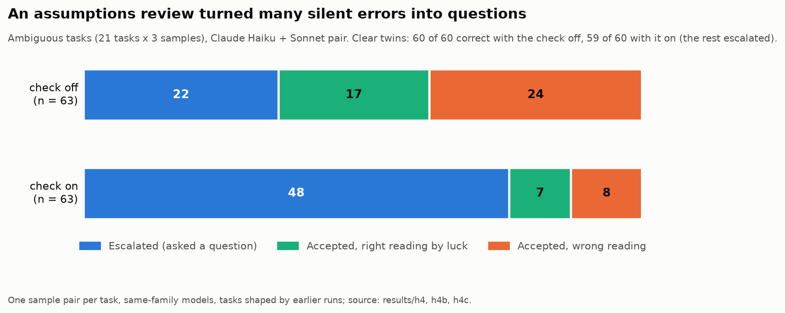

# Silent resolution of ambiguity in AI-written clinical code, and what double programming misses (research prototype)

*A research prototype on public data. Not validated software, and not intended for regulatory submissions. Every number below comes from a logged run summarized under `results/`, the task files under `benchmark/tasks/` (task counts) or the spend log in `docs/STATUS.md` (cost). Single-author labels, small samples and correlated draws limit every claim; see Limits.*

## One-paragraph summary

Tare is a benchmark and harness for a question from clinical statistical programming: when AI writes the code that derives analysis datasets (CDISC ADaM), does a second, independent AI programmer catch its errors? It runs model-written code in an isolated sandbox, scores every output against exact answers generated by the open-source `admiral` templates, and logs every model call. The main finding is about where AI programming is reliable and where it is not. Claude Haiku 5.5 and Sonnet 5.5 were reliable on explicit specs: no silent errors on 20 explicit derivation specs, and none on harder explicit tasks with changed sponsor rules or heavily perturbed inputs, apart from one missing-value bug. (A week-1 kill test had set "at least 3 silent errors in 20" as the bar for the project's original premise; it was not met, so the project turned to the next question.) The weak point is underspecified specs: on deliberately ambiguous tasks the models resolved the open point silently and almost never asked, and where two models resolved it the same way, a comparison of their outputs saw agreement and would have accepted the wrong answer. A reviewer that reads both programmers' written assumptions removed some of these silent errors in a pair of Claude models (from 24 to 8 over three samples, with 1 false alarm in 60 clear pairs) and had a measured blind spot: cases where both programmers stated the same reading. Follow-up tests set the limits of that result: a held-out test was inconclusive, and on a new set of 7 ambiguous tasks (E9) the same reviewer caught 5 of 12 would-be silent errors, while a reviewer built to name competing readings caught all 12 only by asking on most clear specs too.

**What was built.** A frozen 79-task benchmark with matched ambiguous and clear specs and stored alternative readings; a harness with a no-network sandbox, an isolation guard enforced in code and tests, a comparator, an adjudicator and an assumptions reviewer; and a set of pre-registered experiments whose results, including the ones that did not go the way the plan expected, are logged under `results/` with their costs.

**What was and was not tested.** The double-programming pair that was run in the harness was same-family (Claude Haiku and Sonnet) or local (qwen3-coder and gpt-oss); no R programmer and no OpenAI model were run, so the cross-family, cross-language pairing the project was designed around has not been measured. The ambiguous tasks were written to be ambiguous, so silent resolution on them is partly by construction; the results say that models do not ask and that agreement hides it, not how often real sponsor specs are ambiguous.

## Setup

- **Oracle:** answers come from the open-source `admiral` templates run on `pharmaversesdtm` (K1: reproduces the packaged ADSL and ADLB exactly and ADAE except 3 of 107 variables; the date-shift metamorphic test holds with 0 mismatches; `results/k1/summary.md`). Sponsor variants, perturbed inputs and an ophthalmology held-out slice are built from patched templates or admiral functions.
- **Benchmark (79 tasks at the time of writing):** explicit tasks; ambiguous tasks, each with a matched clear twin where one exists (29 ambiguous tasks, 28 of them with a clear twin; 61 stored alternative readings; 73 dev tasks and 6 held-out; eleven of the dev tasks were added after the last full model runs and have only had a one-sample spot check); sponsor-variant and perturbed-input tasks; six held-out ophthalmology tasks. (A later unseen set of ambiguous tasks, round `u1`, was built after the benchmark was frozen and is kept outside the `benchmark-v1.0` tag; it is used only in finding 5.) For ambiguous tasks the oracle holds one reading and the task file stores other defensible readings (`readings:`), so a silent error that equals a stored reading is recorded as such. Specs are written in our own words.
- **Scoring:** correct, silent error (valid output, wrong values), loud error (no valid output), escalated. Escalation is never counted as an error.
- **Harness:** programmers run in a Docker sandbox with no network and no oracle access (checked in code and tests); a deterministic comparator; an adjudicator for disagreements; an optional assumption check. Every model call is logged.

## Findings

**1. Frontier models did not make silent errors on explicit specs.**

| Run | Result |
|---|---|
| K2, 20 seed tasks (10 standard, 10 sponsor variants) | Haiku 5.5 20 of 20 correct, Sonnet 5.5 20 of 20 correct; the pre-set pass line (at least 3 of 20 silent errors) was not met (`results/k2_frontier/summary.md`) |
| P1e, 3 hard sponsor-variant tasks, 3 samples | Haiku 9 of 9, Sonnet 8 of 9; the one error wrote `0001-01-01` for missing dates (`results/p1e/summary.md`) |
| P1f, 3 explicit tasks and 1 ambiguous twin on perturbed AE dates (partial and blank dates), 3 samples | 24 of 24 correct for both models (`results/p1f/summary.md`) |
| Local models on the 20 seed tasks | qwen3-coder:30b 51 of 60 samples correct with 4 silent errors; qwen2.5-coder:7b 25 of 60 (`results/k2_local/summary.md`, `results/k4/summary.md`) |

**2. On ambiguous specs, models resolve the open point silently and rarely ask, and agreement between programmers hides it.**

Single-programmer runs with a prompt that allows `ESCALATE: <question>` (45 ambiguous-task samples per Claude model, from `results/p1bc/` and `results/p1ad/`): Haiku 5.5 17 correct (the oracle's reading, no question), 28 silent errors, 0 escalations; Sonnet 5.5 26 correct, 17 silent errors, 2 escalations. All of the Claude models' silent errors (28 and 17, 45 in total) equal a stored defensible reading. On the matching clear twins the Claude models were correct in 89 of 90 samples, so the divergence is about the open point. In the earlier harder round, 0 of 165 samples across models escalated (`results/k2b/summary.md`). A stronger instruction raised Haiku's ask rate on ambiguous specs from 0 of 15 to 9 of 15, with 8 false alarms in 18 clear samples; Sonnet 5.5 moved 0 to 1 of 15 (`results/e8/summary.md`).

Agreement between programmers hides this: Haiku and Sonnet produced the identical wrong output in 8 of 9 samples where both were wrong, and `gpt-oss:20b` from a different family matched them on two of the three ambiguous tasks they got wrong (`results/k2b/summary.md`; preview, small sample). In the first two-programmer harness run on local models, the programmers agreed on the same non-oracle reading in 2 of 6 ambiguous pairs and the harness accepted both (`results/h1/summary.md`, a smoke run: 12 pairs, 1 sample).

**3. A reviewer that reads both programmers' assumptions reduced silent errors with Claude programmers, with a known blind spot.**

Pair of Claude Haiku 5.5 and Sonnet 5.5 with Sonnet 5.5 as adjudicator and reviewer, prompt requiring an `ASSUMPTIONS:` list, 41 tasks (21 ambiguous, 20 clear twins), three samples (`results/h4/summary.md`, `results/h4b/`, `results/h4c/summary.md`):

| | sample 1 | sample 2 | sample 3 | all |
|---|---|---|---|
| ambiguous pairs that would be silent errors with no reviewer (reviewer-off replay) | 6 | 7 | 10 | 23 |
| reviewer escalated on those | 4 | 5 | 6 | 15 |
| reviewer escalated on clear pairs (false alarms) | 1 of 20 | 0 of 20 | 0 of 20 | 1 of 60 |
| silent errors on the 21 ambiguous tasks, check off then on | 6 to 2 | 8 to 3 | 10 to 3 | 24 to 8 |

Figure: counts from `results/h4`, `results/h4b` and `results/h4c` (built by `scripts/make_figures.py`).

Caveat: the tasks and stored readings were shaped by earlier runs of the same models, and the held-out test (finding 4) could not confirm the effect. The same two cases passed in all three samples: the first-dose-day boundary in `adae-trtemfl-amb` and `adlb-ontrtfl-amb`, where both programmers wrote the same reading with a reason. Local models and Claude Haiku 5.5 as reviewer did not discriminate (Haiku asked on 10 of 20 clear pairs, gpt-oss on 15 of 20, qwen3-coder on almost nothing; `results/h4/summary.md`).

**4. The held-out test of an improved reviewer was inconclusive.** On the six held-out ophthalmology tasks (10 samples each) the Claude programmers asked on 18 of 20 ambiguous pairs themselves and the other two matched the oracle's reading, so the reviewer had nothing to catch (0 would-be silent errors, against a pre-registered minimum of 10). The new reviewer prompt asked on 16 of 36 consulted clear pairs against 3 of 36 for the original, so it was not adopted (`results/h5/summary.md`).

**5. On a new set of ambiguous tasks the assumptions reviewer caught fewer, and the competing-readings reviewer asked almost always.** The set (E9) was built after the benchmark freeze, from rule types where the programmers had stayed quiet (on-treatment and first-dose-day boundaries, end dates, imputed and missing dates). 14 ambiguous tasks were built and screened with the two programmers alone; the 7 on which neither programmer asked were kept (the pre-registered minimum was 8; the run went ahead on 7). Each kept task and its clear twin ran with the Claude pair (Haiku 5.5 and Sonnet 5.5, Sonnet adjudicator), 3 samples: 42 pairs (`results/e9/summary.md`).

| | ambiguous pairs: silent errors | clear pairs escalated |
|---|---|---|
| No reviewer (replay) | 12 | 0 of 21 |
| Assumptions reviewer R1 (live) | 7 (caught 5 of the 12) | 0 of 21 |
| Competing-readings reviewer R2 (replay) | 0 (escalated all 12, and all 21 ambiguous pairs) | 12 of 21 |

All 12 would-be silent errors were pairs where the programmers agreed and neither asked, and they come from 4 tasks with 3 samples each. The pre-registered bar for R1 (at least half of the would-be silent errors with at most 5% false alarms) was not met: 5 of 12, with no false alarms; by task, 3 of 3 on the exposure end date, 1 of 3 on each of two on-treatment flags and 0 of 3 on the treatment-emergent flag, where both programmers wrote that an event on the first dose day does not count and gave a reason. R2 escalated on all 12, but also on 12 of 21 clear pairs and on 33 of 42 pairs overall, so its catch rate comes from asking almost always. Only 3 of the 12 silent errors equal a stored alternative reading; the other 9 resolve missing dates and boundaries in combinations the stored readings do not cover. Not checked: that in all 12 pairs both assumption lists state the same choice (verified by reading one sample of each of the 4 tasks). Reason for caution: 4 contributing tasks, correlated samples, a same-family pair, and tasks written after seeing where the programmers are quiet.

## What this does and does not show

- Frontier models were reliable on explicit specs, so the project's original premise (silent errors there that a second AI would need to catch) was not supported on these tasks; the week-1 kill tests surfaced this early and the project moved to ambiguity.
- Supported for this benchmark and these models: silent resolution of ambiguity is the dominant error; model agreement hides it; asking can be elicited only unevenly and with false alarms; an assumptions review helped in a same-family Claude pair on the tasks it was developed with, and caught fewer (5 of 12) on a new set, with the same blind spot for shared stated assumptions.
- Not shown: any rate for other models, other datasets or real sponsor specs; that cross-family pairs behave differently (only local cross-family pairs were run, and an OpenAI key was never set up); that the assumption check generalizes: the one test on new tasks (E9) was weaker than the development runs, and the reviewer that caught more did so by asking on most clear specs.

## Limits

- One author wrote the ambiguity labels, the stored defensible readings and the specs; no clinical programmer has rated them (a blinded rating sheet exists, `docs/ratings/`, and has not been used).
- Small samples: most cells are 3 samples per task, correlated; the harness runs are 12 to 41 tasks with 1 to 2 samples. Treat counts as directions.
- The ambiguous tasks were written to be ambiguous and are not a sample of real sponsor specs; the frequency of such ambiguity in practice is unknown.
- The double-programming pairs that were run are same-family (Claude) or local; cross-family and cross-language pairs with frontier models were not run.
- Some stored readings were added after seeing model outputs (noted in `results/p1bc/summary.md` and `results/p1gh/summary.md`), and the dev ambiguous tasks were shaped by earlier runs of the same models.
- The ophthalmology oracle is our own script using admiral functions, not an admiral template.
- Public, mostly CDISC pilot data; likely seen in training. Sponsor variants and perturbations are the controls; they produced only one Claude error (the missing-value bug above).
- API spend: $9.92 over the whole project (spend log in `docs/STATUS.md`); local runs are free. Two paid runs exceeded their estimates ($2.02 against $1.5, and $1.80 against $1.55 for E9) and are recorded as such.

## Reproduce

`make setup-data`, `make sandbox-image`, `make references`, then `.venv/bin/tare run --config configs/<name>.yaml` (single programmer, or `mode: pair`; `replay_from` reruns only the decision stage on logged programmers). Run summaries and score records are under `results/`.
